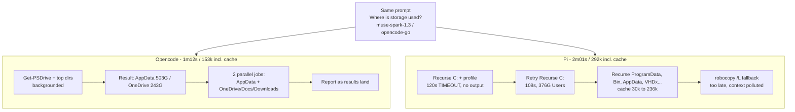

**TL;DR:** Asked *"Where is more storage being used? Give me a report here."* in `C:\Users\ShivamNarkar` with `muse-spark-1.3-contributor` via `opencode-go` on both harnesses. Opencode finished in ~1m12s with ~18k fresh tokens; Pi took ~2m1s and ~292k cache-inclusive tokens. Same answer, same disk (C: 860.7GB used / 92GB free). The gap is harness behavior, not model smarts — and cost barely moved because the extra tokens were cheap cache reads.

## The two paths

## Setup (apples to apples)

- Prompt (identical): `Where is more storage is being used ? Give me a report here.`
- Cwd (identical): `C:\Users\ShivamNarkar`
- Model (identical): `muse-spark-1.3-contributor`, provider `opencode-go`, variant `medium`
- Opencode session: `ses_ed9426fe5ffeg0LQGx57onB5R3` ("Storage usage report request", agent `ponytail`)
- Pi session: `2026-10-10T16-53-23-562Z_01a126bb-c9e9-76b4-acba-bf48d2b022e2` (starts on `opencode-zen-free`, switched to `opencode-go/muse-spark-1.3-contributor` at 16:53:47, aborted first turn)
- User-measured headline: 18.2k vs 297k tokens, 1m12s vs 2m1s

## Per-run logs

From `~/.local/share/opencode/opencode.db` and `~/.pi/agent/sessions`:

| Harness | Input | Output | CacheRead | Total (in+out+cache) | Fresh (in+out) | Cost | Wall |
|---|---|---|---|---|---|---|---|
| Opencode (session total) | 16,444 | 3,981 | 132,571 | 152,996 | 20,425 | $0.00307 | 1m12s measured / 3m48s session span |
| Pi ex.1 (5 turns) | 7,825 | 1,932 | 30,660 | 40,417 | 9,757 | $0.00123 | ~51s |
| Pi ex.2 (17 turns) | 7,026 | 8,615 | 236,161 | 251,802 | 15,641 | $0.00290 | ~120s |
| Pi session total | ~14,851 | ~10,547 | ~266,821 | ~292,219 | ~25,398 | ~$0.00413 | 2m01s measured / 4m18s session span |

Why two token numbers? The 18.2k / 297k headline is **fresh tokens as the UI reports them**; the DB totals above are **cache-inclusive**. Fresh-token ratio: ~20k vs ~25k (~1.2x). Cache-inclusive ratio: ~153k vs ~292k (~1.9x). Headline ratio: ~16x. All three are true under different accounting — which is itself the finding: Pi's tax is almost entirely re-read context, not new reasoning.

## What each harness actually did

**Opencode (22 messages, 3 shell jobs, all backgrounded):**

1. One shot: `Get-PSDrive` + top-level dirs in `$env:USERPROFILE`, backgrounded immediately.
2. When that returned (`C: 860.7/92GB`, `AppData 503GB`, `OneDrive-AIQ 242GB`, `Documents 73GB`), two parallel jobs: AppData breakdown + OneDrive/Documents/Downloads breakdown.
3. Reported as results landed (`AppData\Local 499GB`, OneDrive subfolders, etc.). Never blocked on a full-tree `Recurse`.

**Pi (22 turns across 2 exchanges, sequential PowerShell):**

1. Started with full recursive scans: `Get-ChildItem C:\ -Recurse`, `Get-ChildItem $env:USERPROFILE -Recurse` — the latter **timed out after 120.4s** with no output.
2. Retried the same shape on `C:\` (108.9s, succeeded: `C:\Users 376GB`, `C:\Windows 54GB`...), then `ProgramData`, `$Recycle.Bin`, `AppData\Local`, Docker VHDx hunts — each full `Recurse` + `Measure-Object`, each dumping megabytes of listing into context.
3. Fell back to `robocopy /L` for sizing when PowerShell proved slow. Correct instinct, but after the context was already polluted — hence cacheRead ballooning from 30k (ex.1) to 236k (ex.2).

Same conclusion (AppData + OneDrive + Documents are the hogs), different path: Opencode fanned out and moved on; Pi ground through the whole tree sequentially.

## Why tokens and time don't scale together

- Opencode: 20k fresh / 72s ≈ 280 tok/s fresh; 153k incl. cache / 228s ≈ 670 tok/s.
- Pi: 25k fresh / 121s ≈ 210 tok/s fresh; 292k incl. cache / 258s ≈ 1,130 tok/s.

Fresh-token throughput is nearly identical (~200–280 tok/s) — same model, same speed. The extra ~140k cache-inclusive tokens cost Pi only ~49s extra because cache reads are fast and cheap. If those had been output tokens, the run would have taken 10+ minutes.

## Cost: the surprise non-story

$0.00307 vs $0.00413 — **1.3x, not 16x.** Cache reads are priced near zero on this provider, so Pi's 2x context bloat barely dented the bill. The real price of Pi's approach isn't dollars here, it's context-window occupancy (236k re-reads in one exchange) and the 120s timeouts that stall the user.

## Takeaways

1. **Background + fan-out beats sequential deep scans.** Opencode's 3 background jobs overlapped the slow `Recurse`; Pi paid two 100s+ blocking scans serially.
2. **Never `Recurse` the world.** Top-level fan-out (`Get-ChildItem -Directory`, then drill into the top 3) gets 95% of the answer for 5% of the output.
3. **Report the accounting.** Fresh tokens (what the UI shows), cache-inclusive tokens (what the DB stores), and cost move independently. Quote all three or the 16x headline misleads.
4. `n=1`, one task shape (disk forensics favors fan-out). Open-ended research would narrow the gap. Three runs each + input/output/cache split is the bar for quoting a multiple.

## Reproduce

- Opencode: `~/.local/share/opencode/opencode.db` → `session` id `ses_ed9426fe5ffeg0LQGx57onB5R3` → `session_message` (22 rows).
- Pi: `~/.pi/agent/sessions/--C--Users-ShivamNarkar--/2026-10-10T16-53-23-562Z_01a126bb-c9e9-76b4-acba-bf48d2b022e2.jsonl` → `turn-stats` lines 20, 56 + `session-usage` line 57.
